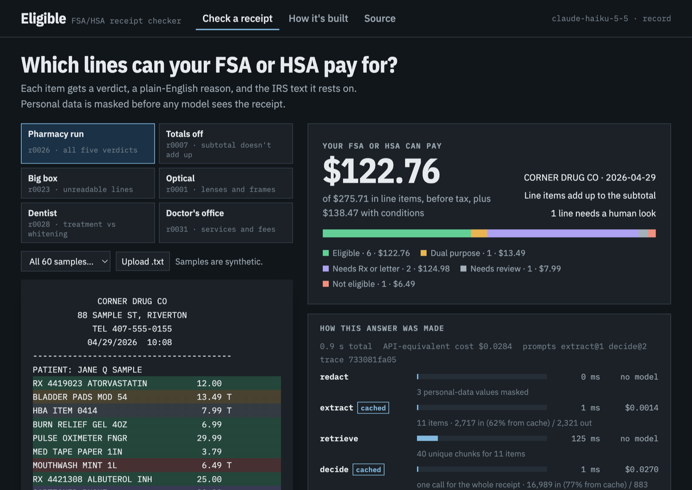
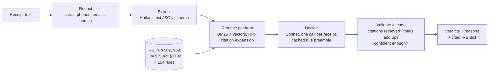
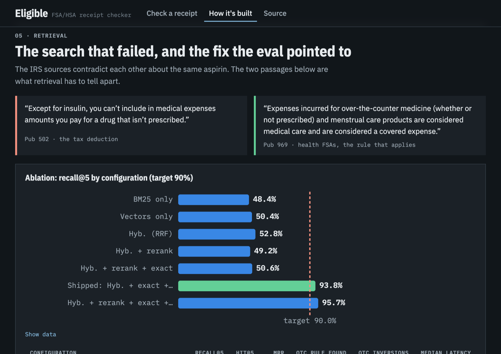

# Eligible

**An FSA/HSA receipt checker that cites the IRS for every answer, and measures itself.**
Upload a receipt and get each line's verdict (eligible, not eligible, dual purpose, needs a
prescription, or needs review), a plain-English reason, and the IRS text it rests on. Behind
it: structured extraction, hybrid retrieval, citation-checked decisions, an eval suite with
gates, and cost tracked down to the token.



## Results

Every number below is copied by `scripts/readme_results.py` from a committed eval report.

<!-- RESULTS:START -->
<!-- RESULTS:END -->

The cost aim of < $0.01 per receipt is **missed**, and the miss is reported, not hidden.
M5 cut cost by half without losing accuracy (below); the remaining cost is mostly the decision
call's IRS text.

## What this project demonstrates

| Skill | How it shows up here | Where |
|---|---|---|
| **LLM structured extraction** | One strict-schema call per receipt, typed with Pydantic, money kept exact, per-field confidence | [`extract/`](src/eligible/extract/__init__.py) |
| **RAG with citations** | SQLite FTS5 (BM25) + sqlite-vec vectors fused with RRF, optional cross-encoder rerank, and *citation expansion*: the fix for a retrieval failure the eval found | [`retrieve/`](src/eligible/retrieve/search.py), [ablation](evals/reports/retrieval-ablation.md) |
| **Evals as the product** | 60 labeled receipts (441 items), smoke/full/adversarial suites, gates, confusion matrix, failure reports | [`evals/`](evals/run.py), [reports](evals/reports/) |
| **Cost and token engineering** | Decimal price table with cache tiers, pre-flight budget, no silent model downgrade, response cache (reruns cost $0), cached knowledge preamble, per-stage cost | [`llm/`](src/eligible/llm/), [cost model](docs/cost-model.md) |
| **Model selection by measurement** | Haiku reads receipts, Sonnet decides; chosen because the eval showed equal accuracy at 13x lower extraction cost | [iterations](evals/reports/iterations.md) |
| **Guardrails** | Personal data masked before any model call, invented citations removed in code, uncertain lines routed to human review, prompt-injection suite | [`redact.py`](src/eligible/redact.py), [`validate.py`](src/eligible/validate.py), [`data/adversarial.py`](data/adversarial.py) |
| **Production Python** | FastAPI, Pydantic v2, `mypy --strict`, ruff, 88 unit tests with no network, CI on every push | [`api.py`](src/eligible/api.py), [`tests/`](tests/), [CI](.github/workflows/ci.yml) |

## How it improved: eval-driven iteration (M5)

The first full eval passed every gate but sent 12% of items to human review (labels: 5%) and
cost $0.050 a receipt. Four measured changes, each committed and re-run on all 441 items:

| Change | Accuracy | Sent to review | Cost / receipt |
|---|---|---|---|
| Baseline | 92.7% | 12.2% | $0.0500 |
| 1. Resolve citation IDs the model shortened | 93.9% | 11.1% | $0.0500 |
| 2. Put all 154 rules in a cached knowledge preamble | 97.5% | 7.5% | $0.0484 |
| 3. Trim IRS chunks to the sentences that matter | 97.5% | 7.5% | $0.0373 |
| 4. Haiku reads receipts, Sonnet decides | 97.7% | 7.5% | $0.0245 |

Labels were never edited to raise a score. Details and the failure analysis that drove each
change: [`evals/reports/iterations.md`](evals/reports/iterations.md).

## How it works



The hard part, found by the eval: the IRS never says "ibuprofen", it says "over-the-counter
medicine". And Publication 502 (the tax deduction) says non-prescribed drugs *aren't*
covered, while Publication 969 (FSAs) says they *are*. Keyword and vector search both missed
the governing rule (recall@5 53%). Following each list rule's own IRS citations fixed it
(94%). The full story is on the `/engineering` page:



## Run it

```
uv sync
uv run python -m eligible.retrieve.ingest      # build the search index (local models)
uv run uvicorn eligible.api:app                # demo on http://localhost:8000, notes on /engineering
uv run pytest                                  # unit tests, no network
uv run python -m evals.run --suite smoke       # 10 receipts through the whole pipeline
uv run python -m evals.run --suite full        # all 60; writes evals/reports/latest.md
uv run python -m evals.run --suite adversarial # injection, OCR noise, damaged layout
uv run python -m evals.retrieval               # retrieval ablation
uv run python -m eligible.demo                 # offline demo of the budget and cache layer
```

LLM calls go through one interface ([`llm/client.py`](src/eligible/llm/client.py)). With
`ANTHROPIC_API_KEY` set it uses the Anthropic API; without one it runs through the Claude Code
CLI on a signed-in Claude account. Costs are reported at API list prices either way. Other
commands: `python -m data.generate` (synthetic receipts), `python -m eligible.knowledge.sources`
(re-parse the IRS sources), `python -m eligible.llm.report` (spend from the call ledger).

## Production concerns

| Concern | Status | Proof |
|---|---|---|
| Pre-flight token and cost budget | done | `tests/test_budget.py` |
| Cost kill-switch, no fallback to a cheaper model | done | `tests/test_eval_run.py` |
| Strict typed outputs (schema-valid ≠ correct) | done | `tests/test_extract.py`, `tests/test_client.py` |
| Uncertain lines routed to human review | done | full eval: 23 unreadable lines |
| Personal-data redaction before any model call | done | `tests/test_redact.py`, 0 leaks in evals |
| No made-up citations | done | full eval gate: 0 reached a user |
| Prompt-injection resistance | done | adversarial suite gate |
| Eval CI gate on pull requests | planned (M7) | |
| Tracing per step | planned (M7) | |
| Tool calling / MCP server | planned (M6) | |

Details in [`docs/production-concerns.md`](docs/production-concerns.md). Not covered here:
multi-step agent trajectories with a human approval gate. That's the planned follow-up
project (prior-authorization agent).

## Status and limits

M0–M5 are done ([PROGRESS.md](PROGRESS.md)); every change of plan is logged in
[DECISIONS.md](DECISIONS.md). Honest limits:

- **Synthetic data.** 60 generated receipts with labels built from a hand-written rule list
  that cites IRS text. A human spot-check of 20 is still pending ([AUDIT.md](data/golden/AUDIT.md)).
- **Text, not photos, so far.** Image input and blurred-receipt evals need the API backend.
- **The reason-quality judge isn't built yet.** It needs 20 human-labelled reasons to validate.
- **Not deployed yet.** It runs locally.

## Docs

[SPEC.md](SPEC.md) (what it does) · [PLAN.md](PLAN.md) (milestones) · [EVALS.md](EVALS.md)
(metrics and gates) · [DATA.md](DATA.md) (synthetic data and sources) ·
[docs/cost-model.md](docs/cost-model.md) · [CLAUDE.md](CLAUDE.md) (build rules)

Not medical, tax or legal advice. The plan administrator makes the real decision.
