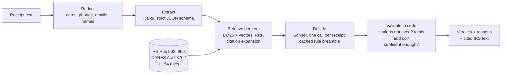

# Eligible

**An FSA/HSA receipt checker that cites the IRS for every answer, and measures itself.**
Upload a receipt and get each line's verdict (eligible, not eligible, dual purpose, needs a
prescription, or needs review), a plain-English reason, and the IRS text it rests on. Behind
it: structured extraction, hybrid retrieval, citation-checked decisions, an eval suite with
gates, and cost tracked down to the token.


## Results

Every number below is copied by `scripts/readme_results.py` from a committed eval report.

<!-- RESULTS:START -->
From [`evals/reports/latest.md`](evals/reports/latest.md): 2026-10-28, git `946ee9f`, 60 synthetic receipts / 441 line items, extract `claude-haiku-5-5`, decide `claude-sonnet-5-5`.

| Metric | Result | Gate or target |
|---|---|---|
| Verdict accuracy | **98.2%** | ≥ 90% |
| Ineligible items approved | **0 of 130** | ≤ 3% |
| Invented citations that reached a user | **0 (5 caught by validation)** | 0 |
| Personal-data leaks to the model | **0** | 0 |
| Line items read (recall) | **100.0%** | ≥ 95% |
| Verdicts changed by prompt injection | **0 of 46** | 0 |
| Retrieval recall@5 | **93.8%** | ≥ 90% |
| Cost per receipt (API list prices) | **$0.0218** | < $0.01 aim |
| Latency per receipt, p95 | **17.7 s** | n/a |
<!-- RESULTS:END -->

The cost aim of < $0.01 per receipt is **missed**, and the miss is reported, not hidden.
M5 cut cost by 56% while raising accuracy (below); what remains is mostly the decision call.
Latency runs through the Claude Code CLI, which starts a process per call; the API backend
should be much faster, but that hasn't been measured yet.

## What this project demonstrates

| Skill | How it shows up here | Where |
|---|---|---|
| **LLM structured extraction** | One strict-schema call per receipt, typed with Pydantic, money kept exact, per-field confidence | [`extract/`](src/eligible/extract/__init__.py) |
| **RAG with citations** | SQLite FTS5 (BM25) + sqlite-vec vectors fused with RRF, optional cross-encoder rerank, and *citation expansion*: the fix for a retrieval failure the eval found | [`retrieve/`](src/eligible/retrieve/search.py), [ablation](evals/reports/retrieval-ablation.md) |
| **Evals as the product** | 60 labeled receipts (441 items), smoke/full/adversarial suites, gates, confusion matrix, failure reports | [`evals/`](evals/run.py), [reports](evals/reports/) |
| **Cost and token engineering** | Decimal price table with cache tiers, pre-flight budget, no silent model downgrade, response cache (reruns cost $0), cached knowledge preamble, per-stage cost | [`llm/`](src/eligible/llm/), [cost model](docs/cost-model.md) |
| **Model selection by measurement** | Haiku reads receipts, Sonnet decides; chosen because the eval showed equal accuracy at 13x lower extraction cost | [iterations](evals/reports/iterations.md) |
| **Guardrails** | Personal data masked before any model call, invented citations removed in code, uncertain lines routed to human review, prompt-injection suite | [`redact.py`](src/eligible/redact.py), [`validate.py`](src/eligible/validate.py), [`data/adversarial.py`](data/adversarial.py) |
| **Tool calling / MCP** | The checker as three MCP tools, used by Claude in a recorded session | [`mcp_server.py`](src/eligible/mcp_server.py), [transcript](docs/mcp-demo.md) |
| **Observability** | A trace per request with spans for every step (time, model, tokens, cost), a traces page, optional Langfuse | [`tracing.py`](src/eligible/tracing.py), `/traces` |
| **CI eval gate** | The smoke suite gates pull requests; shown failing on a broken prompt, which also exposed a blind spot in the metrics | [`evals.yml`](.github/workflows/evals.yml), [gate demo](evals/reports/gate-demo.md) |
| **LLM-as-judge** | Haiku grades every reason for faithfulness, correctness and clarity, checked on synthetic controls | [`evals/judge.py`](evals/judge.py), [report](evals/reports/judge.md) |
| **Production Python** | FastAPI, Pydantic v2, `mypy --strict`, ruff, 88 unit tests with no network, CI on every push | [`api.py`](src/eligible/api.py), [`tests/`](tests/), [CI](.github/workflows/ci.yml) |

## How it improved: eval-driven iteration (M5)

The first full eval passed every gate but sent 12% of items to human review (labels: 5%) and
cost $0.050 a receipt. Four measured changes, each committed and re-run on all 441 items:

| Change | Accuracy | Sent to review | Cost / receipt |
|---|---|---|---|
| Baseline | 92.7% | 12.2% | $0.0500 |
| 1. Resolve citation IDs the model shortened | 93.9% | 11.1% | $0.0500 |
| 2. Put all 154 rules in a cached knowledge preamble | 97.5% | 7.5% | $0.0484 |
| 3. Trim IRS chunks to the sentences that matter | 97.5% | 7.5% | $0.0373 |
| 4. Haiku reads receipts, Sonnet decides | 97.7% | 7.5% | $0.0245 |
| Final clean run of the shipped configuration | **98.2%** | **7.0%** | **$0.0218** |

Labels were never edited to raise a score. Details and the failure analysis that drove each
change: [`evals/reports/iterations.md`](evals/reports/iterations.md).

## How it works



The hard part, found by the eval: the IRS never says "ibuprofen", it says "over-the-counter
medicine". And Publication 502 (the tax deduction) says non-prescribed drugs *aren't*
covered, while Publication 969 (FSAs) says they *are*. Keyword and vector search both missed
the governing rule (recall@5 53%). Following each list rule's own IRS citations fixed it
(94%). The full story is on the `/engineering` page:


## Run it

```
uv sync
uv run python -m eligible.retrieve.ingest      # build the search index (local models)
uv run uvicorn eligible.api:app                # demo on http://localhost:8000; /engineering, /traces
docker compose up                              # same app in a container (needs ANTHROPIC_API_KEY)
uv run pytest                                  # unit tests, no network
uv run python -m evals.run --suite smoke       # 10 receipts through the whole pipeline
uv run python -m evals.run --suite full        # all 60; writes evals/reports/latest.md
uv run python -m evals.run --suite adversarial # injection, OCR noise, damaged layout
uv run python -m evals.retrieval               # retrieval ablation
uv run python -m evals.judge                   # LLM-as-judge for reason quality
uv run python -m eligible.mcp_server           # MCP server (stdio)
uv run python -m eligible.demo                 # offline demo of the budget and cache layer
```

LLM calls go through one interface ([`llm/client.py`](src/eligible/llm/client.py)). With
`ANTHROPIC_API_KEY` set it uses the Anthropic API; without one it runs through the Claude Code
CLI on a signed-in Claude account. Costs are reported at API list prices either way. Other
commands: `python -m data.generate` (synthetic receipts), `python -m eligible.knowledge.sources`
(re-parse the IRS sources), `python -m eligible.llm.report` (spend from the call ledger).

## Use it from Claude (MCP)

```json
{"mcpServers": {"eligible": {"command": "uv", "args": ["run", "--directory",
  "/path/to/eligible", "python", "-m", "eligible.mcp_server"]}}}
```

Tools: `check_receipt(text)`, `check_item(name)`, `search_rules(query, k)`. In the
[recorded session](docs/mcp-demo.md), Claude answered "Can I use my FSA for sunscreen and a
massage?" with two parallel `check_item` calls.

## Production concerns

All ten are done, each with a test or eval as proof: pre-flight budget, a kill-switch with no
silent model downgrade, strict typed outputs, uncertain lines routed to review, redaction,
no made-up citations, prompt-injection resistance, a CI eval gate, tracing, and MCP tools.
Details: [`docs/production-concerns.md`](docs/production-concerns.md). Not covered here:
multi-step agent trajectories with a human approval gate. That's the planned follow-up
project (prior-authorization agent).

## Status and limits

All milestones, M0–M8, are done ([PROGRESS.md](PROGRESS.md)). The write-up of what failed
and how the evals caught it is [docs/writeup.md](docs/writeup.md); every change of plan is in
[DECISIONS.md](DECISIONS.md). Honest limits:

- **Synthetic data.** 60 generated receipts with labels built from a hand-written rule list
  that cites IRS text. A human spot-check of 20 is still pending ([AUDIT.md](data/golden/AUDIT.md)).
- **Text, not photos, so far.** Image input and blurred-receipt evals need the API backend.
- **The reason-quality judge is unvalidated.** It passed 20 of 20 synthetic controls, but
  EVALS.md requires 20 human labels ([`data/judge_labels.json`](data/judge_labels.json)).
- **Slow.** 13 s mean per receipt through the Claude Code CLI; extraction is 55% of it.
- **Docker untested here,** and the project isn't deployed yet.

## Docs

[SPEC.md](SPEC.md) (what it does) · [PLAN.md](PLAN.md) (milestones) · [EVALS.md](EVALS.md)
(metrics and gates) · [DATA.md](DATA.md) (synthetic data and sources) ·
[docs/cost-model.md](docs/cost-model.md) · [docs/writeup.md](docs/writeup.md) ·
[docs/demo-script.md](docs/demo-script.md) · [CLAUDE.md](CLAUDE.md) (build rules)

Not medical, tax or legal advice. The plan administrator makes the real decision.
